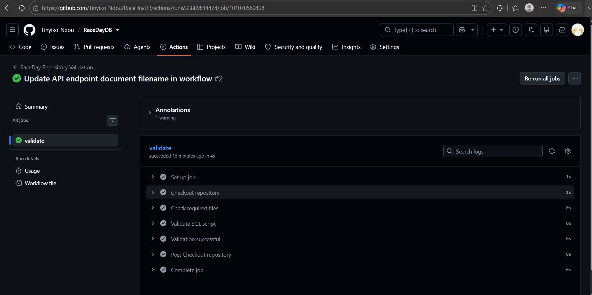

RaceDay event management system (PART 1)

- System Description

RaceDay is a web-based event management system designed to manage
running, walking and cycling events in South Africa.

The system allows organisers to create and manage events, categories,
routes and event information. Participants can browse events, enrol
in events and view their results.

- User Roles
- 
-Participant
Participants can:
- Register and log in
- View available events
- View event categories
- Enrol in events
- View their enrolments
- View their results
- 
- Organiser
Organisers can:
- Register and log in
- Create events
- Update events
- Manage event categories
- Manage routes
- Record participant results
- Manage event information

- Database

The RaceDay database is implemented using Microsoft SQL Server.

The database script can be found in:

`/docs/RaceDayDB.sql`

-ERD

The Entity Relationship Diagram can be found in:

`/docs/RaceDay_ERD.pdf`

- API Endpoint Plan

The API Endpoint Plan can be found in:

`/docs/RaceDay_API_Endpoint_Plan.docx`

YOUTUBE LINK
https://youtu.be/2ROQP0NRUBI

## CI/CD Pipeline

# RaceDay — Part 2: ASP.NET Core Web API

## 1. Project Overview

RaceDay is a web-based event management system designed to support running, walking and cycling events in South Africa.

Part 2 implements a RESTful API using ASP.NET Core Web API, Entity Framework Core and SQL Server. The API provides authentication, role-based access, event management, categories, participant enrolments and results.

## 2. Technologies Used

- C# and ASP.NET Core Web API

- .NET 10

- Entity Framework Core

- Microsoft SQL Server

- JWT bearer authentication

- Swagger / OpenAPI

- xUnit for automated tests

- Git and GitHub

- GitHub Actions for continuous integration

## 3. User Roles

### Organiser

Organisers can:

- Register and log in.

- View and update their own profile.

- Create and manage their own events.

- Manage event categories.

- View enrolments for their events.

- Record participant results for their events.

### Participant

Participants can:

- Register and log in.

- View and update their own profile.

- Browse available events and categories.

- Enrol in events.

- View their own enrolments.

- View their own results.

## 4. Main API Endpoints

| Method | Endpoint | Purpose |

|---|---|---|

| POST | `/api/Auth/register` | Register a user |

| POST | `/api/Auth/login` | Log in and obtain a JWT |

| GET | `/api/Profile/me` | View own profile |

| PUT | `/api/Profile/me` | Update own profile |

| GET | `/api/Event` | List events |

| GET | `/api/Event/{id}` | View an event |

| POST | `/api/Event` | Create an event |

| PUT | `/api/Event/{id}` | Update an event |

| DELETE | `/api/Event/{id}` | Delete an event |

| GET | `/api/Categories` | List categories |

| POST | `/api/Categories` | Create a category |

| POST | `/api/Categories/events/{eventId}` | Link a category to an event |

| POST | `/api/Enrolments` | Enrol in an event |

| GET | `/api/Enrolments/mine` | View own enrolments |

| GET | `/api/Enrolments/event/{eventId}` | View enrolments for an owned event |

| POST | `/api/Results/enrolment/{enrolmentId}` | Record a result |

| GET | `/api/Results/mine` | View own results |

The complete endpoint list should be checked against the final implementation and the Part 1 API Endpoint Plan.

## 5. Authentication and Security

The API uses JWT bearer tokens to authenticate requests. Protected endpoints require a valid token, and role-based authorization restricts Organiser and Participant operations.

Passwords are stored as password hashes rather than plain text. Profile endpoints operate on the authenticated user's account.

JWT secrets and database credentials must be configured securely and must not be committed to the repository.

## 6. Database

The API connects to the existing RaceDayDB SQL Server database.

The database schema should remain consistent with the Part 1 ERD and SQL script. Database changes must be managed carefully to preserve existing tables and relationships.

## 7. Running the Project Locally

1. Install the .NET 10 SDK.
2. Open the RaceDay API solution in Visual Studio.
3. Configure the `RaceDayConnection` connection string.
4. Configure the JWT key, issuer and audience.
5. Restore NuGet packages.
6. Build the solution.
7. Run the API.
8. Open the Swagger URL launched by Visual Studio, normally ending in `/swagger`.

## 8. Testing

The API should be tested through Swagger and automated tests.
Tests should cover:
- Successful and failed registration.
- Successful and failed login.
- Role-based authorization.
- Event creation and ownership restrictions.
- Category management.
- Enrolment and duplicate enrolment.
- Result recording and participant result access.

- ## CI/CD Pipeline

# RaceDay – Part 3

## 1. Project Overview

RaceDay is a web-based event management system designed to manage running, walking and cycling events.

The system allows Organisers to create and manage sporting events, while Participants can browse available events, enrol in events, manage their profiles and view their results.

Part 3 focuses on developing the MVC web application, integrating it with the existing REST API, implementing role-based functionality and improving the overall user experience.

## 2. Technologies Used

The project uses the following technologies:

- **C#** – Main programming language.
- **ASP.NET Core MVC (.NET 10)** – Web application development.
- **ASP.NET Core Web API** – Backend services and data processing.
- **Entity Framework Core** – Database access and object-relational mapping.
- **Microsoft SQL Server** – Database management.
- **HTML5** – Web page structure.
- **CSS3** – Styling and layout.
- **Bootstrap** – Responsive user interface.
- **JavaScript** – Client-side functionality.
- **JWT Authentication** – Secure user authentication and authorisation.
- **Git and GitHub** – Version control and source code management.
- **Azure Blob Storage** – Image storage, where implemented.

## 3. System Architecture

RaceDay follows a layered architecture consisting of three main components.

### 3.1 MVC Web Application

The MVC application provides the user interface through which Organisers and Participants interact with the system.

It communicates with the API using HTTP requests and displays the information returned by the API.

### 3.2 REST API

The API handles application functionality, authentication, authorisation and communication with the database.

It processes requests from the MVC application and returns responses in JSON format.

### 3.3 Database

Microsoft SQL Server stores the application's information, including:

- User accounts
- Events
- Event categories
- Enrolments
- Results
- Routes
- Weather information

## 4. Main System Features

### 4.1 User Authentication

- User registration.
- User login.
- Password hashing.
- JWT-based authentication.
- Role-based access control.
- Separate Organiser and Participant access.

### 4.2 Organiser Functionality

Organisers can:

- Access the Organiser Dashboard.
- Create sporting events.
- View available events.
- Edit event information.
- Delete events.
- Manage event categories.
- View Participant enrolments.
- Manage event results.

### 4.3 Participant Functionality

Participants can:

- Access the Participant Dashboard.
- Browse available sporting events.
- View event information.
- Enrol in events.
- View their enrolment history.
- View their results.
- Manage their profiles.

### 4.4 Event Management

RaceDay supports three event types:

- Run
- Walk
- Cycle

Event information includes the event name, description, type, date, starting time and location.

### 4.5 Image Uploads

Where Azure Blob Storage integration has been implemented, the application supports uploading and displaying event images and profile pictures.

### 4.6 User Interface

The MVC application provides separate dashboards and navigation options for Organisers and Participants.

The interface is designed to be responsive and easy to navigate.

## 5. Database Design

The RaceDay database is implemented using Microsoft SQL Server.

The database contains the following main tables:

1. Users
2. Events
3. Categories
4. EventCategories
5. Enrolments
6. Results
7. Routes
8. Weather

Primary keys and foreign keys are used to establish relationships between the tables and maintain data integrity.

## 6. Authentication and Security

RaceDay uses JWT authentication to protect API endpoints.

Users receive an authentication token after successfully logging in.

The application uses role-based authorisation to distinguish between Organisers and Participants.

Passwords are hashed before being stored in the database.

Sensitive configuration values, including JWT signing keys and storage connection strings, should not be committed to the public GitHub repository.

## 7. Installation and Setup

### Requirements

- Visual Studio 2022 or a compatible development environment.
- .NET 10 SDK.
- Microsoft SQL Server.
- SQL Server Management Studio (SSMS).
- Git.
- A web browser.

### Steps

1. Clone the RaceDayDB repository from GitHub.
2. Open the solution in Visual Studio.
3. Confirm that the required .NET packages are installed.
4. Configure the database connection string in the API configuration.
5. Confirm that the existing RaceDayDB database is available.
6. Configure the API URL used by the MVC application.
7. Start the RaceDay.API project.
8. Open the Swagger interface to test the API.
9. Start the RaceDay.Web project.
10. Register or log in to the application.

### API Swagger Address

`https://localhost:7003/swagger`

### MVC Web Application

The MVC application runs using its configured development URL.

For the current development environment, the address has been:

`https://localhost:7011`

These local development URLs may differ depending on the launch settings.

## 8. Testing

The application should be tested using the following scenarios:

| Test | Expected result |
|---|---|
| Register a new user | Account is successfully created |
| Log in with correct credentials | User successfully logs in |
| Log in with incorrect credentials | Access is rejected |
| Organiser creates an event | Event is saved |
| Participant browses events | Available events are displayed |
| Participant enrols in an event | Enrolment is recorded |
| Participant views enrolments | Their enrolments are displayed |
| Organiser views enrolments | Enrolments for their events are displayed |
| Organiser adds a result | Result is saved |
| Participant views results | Their results are displayed |
| Participant accesses Organiser-only functionality | Access is denied |

## 9. Version Control

GitHub is used to manage the development and version history of RaceDay.

The Part 3 development branch is:

`part-3-mvc`

Changes are committed regularly to document development progress.

Example commit messages:

- Create Participant dashboard
- Implement Participant event browsing
- Implement Participant enrolment functionality
- Implement Participant results page
- Implement Participant profile management
- Integrate Azure Blob Storage
- Improve responsive layouts
- Add Docker configuration
- Complete Part 3 MVC integration and testing

Only commit messages corresponding to features actually implemented should be used.

## 10. Deployment and Containerisation

Docker can be used to package the RaceDay application into containers, allowing it to run in a consistent environment.

If Docker has been configured, the Dockerfile and associated configuration files should be included in the repository.

Deployment configuration should account for API and database connectivity, environment variables and secure configuration values.

## 11. Conclusion

RaceDay provides a centralised platform for managing running, walking and cycling events.

The Part 3 development extends the existing API and database functionality by introducing an MVC web application with separate functionality for Organisers and Participants.

The system aims to simplify event management, participant enrolment and results management while providing a secure and user-friendly experience.

Further improvements can include additional reporting features, enhanced event filtering, improved image management and deployment to a production hosting environment.

