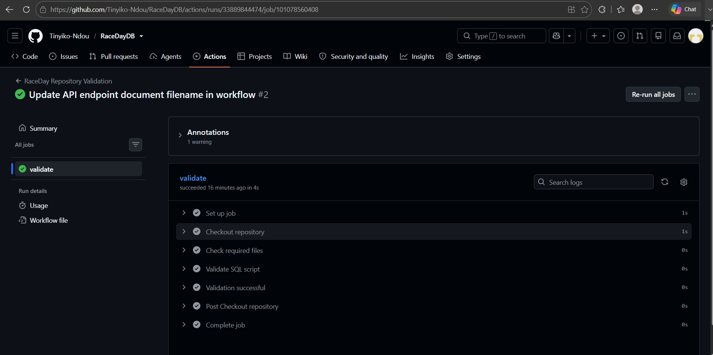

RaceDay event management system (PART 1)

- System Description

RaceDay is a web-based event management system designed to manage
running, walking and cycling events in South Africa.

The system allows organisers to create and manage events, categories,
routes and event information. Participants can browse events, enrol
in events and view their results.

- User Roles
- 
-Participant
Participants can:
- Register and log in
- View available events
- View event categories
- Enrol in events
- View their enrolments
- View their results
- 
- Organiser
Organisers can:
- Register and log in
- Create events
- Update events
- Manage event categories
- Manage routes
- Record participant results
- Manage event information

- Database

The RaceDay database is implemented using Microsoft SQL Server.

The database script can be found in:

`/docs/RaceDayDB.sql`

-ERD

The Entity Relationship Diagram can be found in:

`/docs/RaceDay_ERD.pdf`

- API Endpoint Plan

The API Endpoint Plan can be found in:

`/docs/RaceDay_API_Endpoint_Plan.docx`

YOUTUBE LINK
https://youtu.be/2ROQP0NRUBI

## CI/CD Pipeline

# RaceDay — Part 2: ASP.NET Core Web API

## 1. Project Overview

RaceDay is a web-based event management system designed to support running, walking and cycling events in South Africa.

Part 2 implements a RESTful API using ASP.NET Core Web API, Entity Framework Core and SQL Server. The API provides authentication, role-based access, event management, categories, participant enrolments and results.

## 2. Technologies Used

- C# and ASP.NET Core Web API

- .NET 10

- Entity Framework Core

- Microsoft SQL Server

- JWT bearer authentication

- Swagger / OpenAPI

- xUnit for automated tests

- Git and GitHub

- GitHub Actions for continuous integration

## 3. User Roles

### Organiser

Organisers can:

- Register and log in.

- View and update their own profile.

- Create and manage their own events.

- Manage event categories.

- View enrolments for their events.

- Record participant results for their events.

### Participant

Participants can:

- Register and log in.

- View and update their own profile.

- Browse available events and categories.

- Enrol in events.

- View their own enrolments.

- View their own results.

## 4. Main API Endpoints

| Method | Endpoint | Purpose |

|---|---|---|

| POST | `/api/Auth/register` | Register a user |

| POST | `/api/Auth/login` | Log in and obtain a JWT |

| GET | `/api/Profile/me` | View own profile |

| PUT | `/api/Profile/me` | Update own profile |

| GET | `/api/Event` | List events |

| GET | `/api/Event/{id}` | View an event |

| POST | `/api/Event` | Create an event |

| PUT | `/api/Event/{id}` | Update an event |

| DELETE | `/api/Event/{id}` | Delete an event |

| GET | `/api/Categories` | List categories |

| POST | `/api/Categories` | Create a category |

| POST | `/api/Categories/events/{eventId}` | Link a category to an event |

| POST | `/api/Enrolments` | Enrol in an event |

| GET | `/api/Enrolments/mine` | View own enrolments |

| GET | `/api/Enrolments/event/{eventId}` | View enrolments for an owned event |

| POST | `/api/Results/enrolment/{enrolmentId}` | Record a result |

| GET | `/api/Results/mine` | View own results |

The complete endpoint list should be checked against the final implementation and the Part 1 API Endpoint Plan.

## 5. Authentication and Security

The API uses JWT bearer tokens to authenticate requests. Protected endpoints require a valid token, and role-based authorization restricts Organiser and Participant operations.

Passwords are stored as password hashes rather than plain text. Profile endpoints operate on the authenticated user's account.

JWT secrets and database credentials must be configured securely and must not be committed to the repository.

## 6. Database

The API connects to the existing RaceDayDB SQL Server database.

The database schema should remain consistent with the Part 1 ERD and SQL script. Database changes must be managed carefully to preserve existing tables and relationships.

## 7. Running the Project Locally

1. Install the .NET 10 SDK.
2. Open the RaceDay API solution in Visual Studio.
3. Configure the `RaceDayConnection` connection string.
4. Configure the JWT key, issuer and audience.
5. Restore NuGet packages.
6. Build the solution.
7. Run the API.
8. Open the Swagger URL launched by Visual Studio, normally ending in `/swagger`.

## 8. Testing

The API should be tested through Swagger and automated tests.
Tests should cover:
- Successful and failed registration.
- Successful and failed login.
- Role-based authorization.
- Event creation and ownership restrictions.
- Category management.
- Enrolment and duplicate enrolment.
- Result recording and participant result access.
- 
